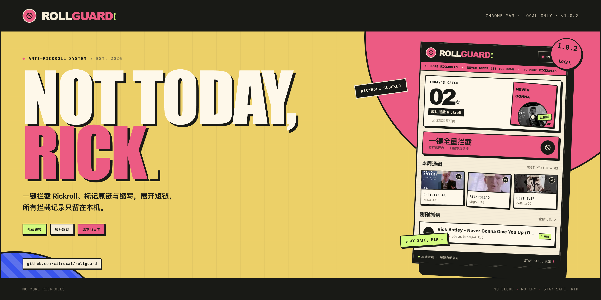
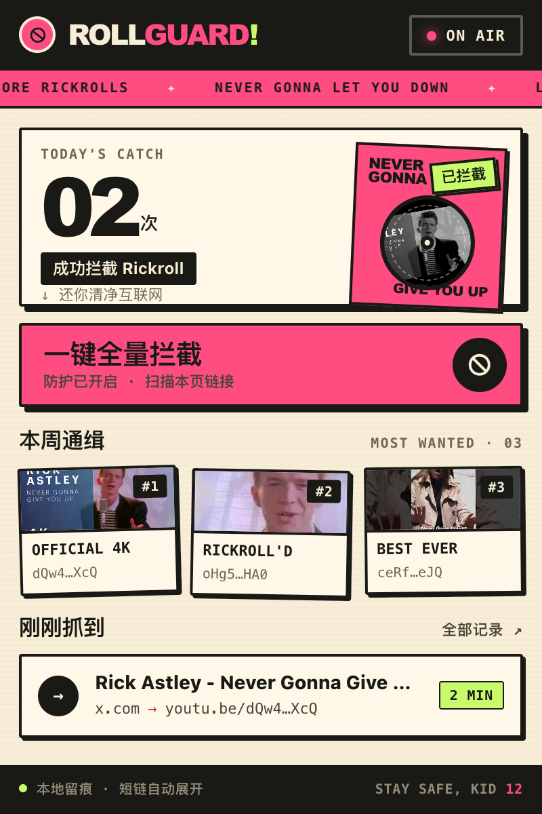
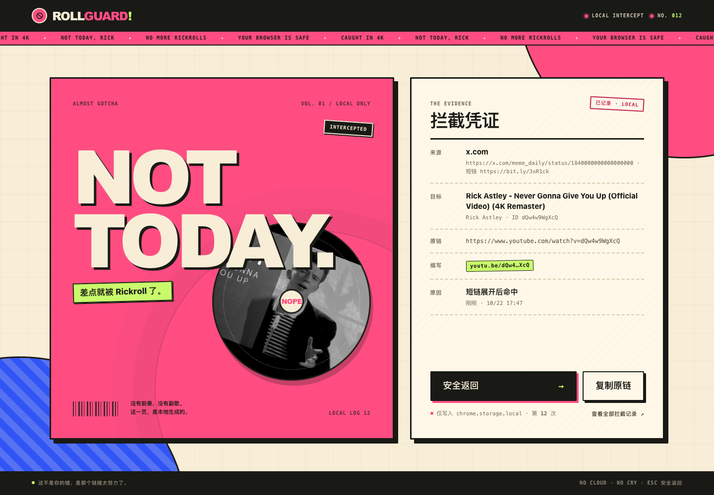
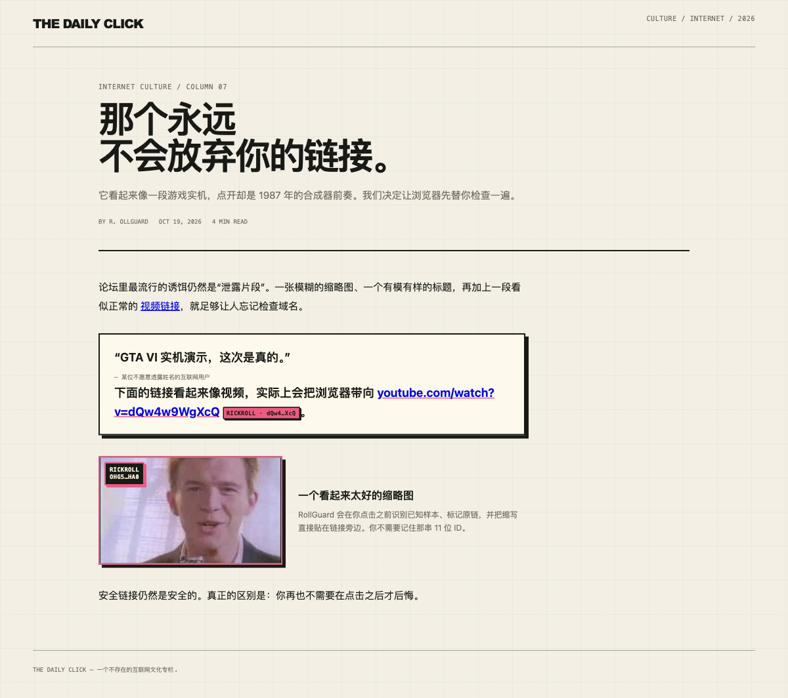
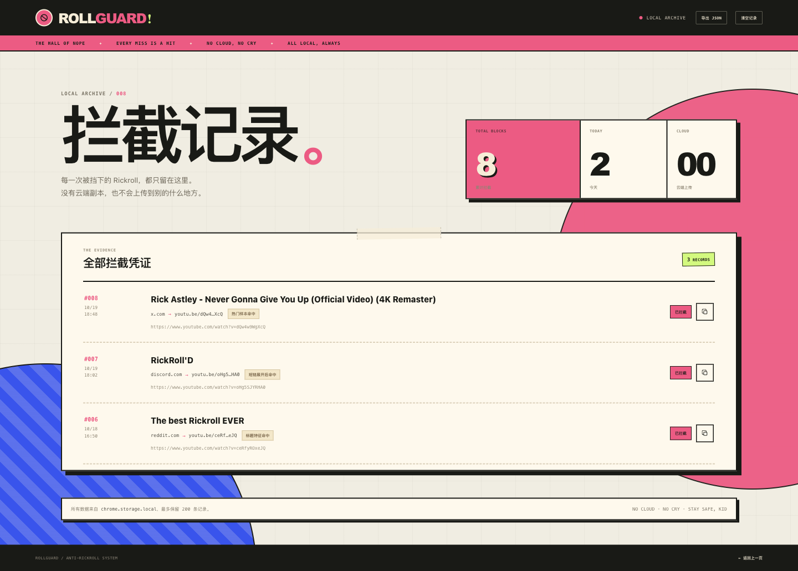

<div align="center">



**把 Rickroll 拦在播放键之前。**

<p>
  <a href="https://github.com/citrocat/rollguard/releases/latest">
    
  </a>
  <a href="#quick-start">
    
  </a>
  <a href="LICENSE">
    
  </a>
</p>

<p>
  
  
  
  
</p>

<p><sub>简体中文</sub></p>

</div>

RollGuard 是一个在链接被打开之前工作的 Chrome MV3 扩展。它会识别已知 Rickroll、展开被藏起来的短链、在网页上标记原链和缩写，并把每一次访问拦截留成一份完全属于本机的档案。

不是阻止你听 Rick Astley。只是让这个决定永远由你做。

## Quick Start

### 1. 下载

从 [Releases](https://github.com/citrocat/rollguard/releases/latest) 下载最新的 `rollguard-<version>.zip`。压缩包内已经是一个可加载的完整扩展，不需要 npm、编译或额外依赖。

### 2. 加载扩展

1. 解压下载的 zip，得到 `rollguard-<version>/` 文件夹。
2. 在 Chrome、Chromium 或 ego lite 打开 `chrome://extensions`。
3. 打开右上角 **开发者模式**。
4. 点击 **加载未打包的扩展程序**，选择解压出的文件夹。
5. 把 RollGuard 固定到工具栏，点击图标打开 Popup。

Chrome 会提示「读取和更改您在所有网站上的数据」。这是页面链接标记、短链展开和 YouTube 导航拦截所必需的；RollGuard 不上传任何浏览数据。

### 3. 一键巡检

安装后默认是 **ON AIR**。打开任意网页，点击 Popup 里的 **一键全量拦截**：

- 当前页面上的已知链接会按结构标记：正文短链用粉底黑字与删除线，块级标题变成 Split Slab，视频卡片盖上整框暗幕；工具栏角标只显示本页已标记数量，数量为 0 时不显示数字
- 可疑短链会在本地展开
- 新发现的样本会一并加入拦截范围

想看真实效果，可以把下面这个地址粘贴到新标签页：

```text
https://www.youtube.com/watch?v=dQw4w9WgXcQ
```

预期结果：先看到 RollGuard 的 **NOT TODAY.** 拦截页，而不是 1987 年的前奏。点击「安全返回」可以回到来源页面。

---

## 它长什么样

### 01 / Popup

<p align="center">
  
</p>

<p align="center"><sub><b>TODAY'S CATCH</b> 统计今天挡下的 Rickroll；工具栏角标则显示当前页已标记数量。一个按钮巡检当前页面；最新一条拦截凭证就在首页。示例数据仅用于展示。</sub></p>

### 02 / 拦截页

<p align="center">
  
</p>

<p align="center"><sub>在进入 YouTube 之前换成本地页面：显示来源、目标视频、原链、缩写、命中原因和写入时间。</sub></p>

### 03 / 网页链接标记

<p align="center">
  
</p>

<p align="center"><sub>正文链接保持 Redline XL；块级标题使用 Split Slab；视频卡片使用 Blackout，暗幕和印章裁在画面内部，标题与元数据始终可读。</sub></p>

### 04 / 本地拦截档案

<p align="center">
  
</p>

<p align="center"><sub>每一条命中都记录来源、原链、缩写和原因。支持复制原链、清空记录和导出 JSON；没有云端副本。</sub></p>

---

## 你会得到什么

| | 能力 | 说明 |
|:---:|---|---|
| **01** | **一键全量拦截** | 扫描当前页面上的 YouTube 链接，展开可疑短链，并把所有发现的 Rickroll 标出来。 |
| **02** | **原链标记 + 缩写** | 正文使用粉底黑字、删除线和实心票签；块级标题变成黑底粉框的 Split Slab；视频卡片使用整框暗幕与印章，并裁在画面矩形内。Google 视频结果这种 `h3 + cite` 复合标题使用独立的直立标签，避免被页面翻转或截断。完整原链与视频 ID 仍保存在档案里。 |
| **03** | **短链展开** | 对 `bit.ly`、`t.co`、`tinyurl.com` 等常见短链先解析最终地址，再决定是否放行。 |
| **04** | **三层识别** | 已知视频 ID、短链重定向、YouTube 标题 / 频道特征。单层漏掉的样本，其他层还能补上。 |
| **05** | **本地留痕** | 拦截来源、目标、原因和时间全部写入 `chrome.storage.local`，最多保留 200 条。 |
| **06** | **随时闭麦** | 点击 Popup 右上角的 ON AIR 可暂停防护；页面标记会同步移除，恢复后重新布防。 |
| **07** | **本页角标** | 工具栏角标显示当前标签页已标记的 Rickroll 数量，切换页面时各自独立；数量为 0 时隐藏数字。 |

## 它如何工作

```text
链接点击 / 地址栏导航
        │
        ▼
┌─────────────────────┐
│ 已知视频 ID 精确命中? │──是──▶ 记录 + 打开本地拦截页
└─────────┬───────────┘
          │否
          ▼
┌─────────────────────┐
│ 短链? → 本地展开重定向 │──Rickroll──▶ 记录 + 拦截
└─────────┬───────────┘
          │否
          ▼
┌─────────────────────┐
│ YouTube 页标题/频道  │──强特征──▶ 暂停视频 + 记录 + 拦截
│ 是否匹配 NGGYU       │
└─────────┬───────────┘
          │否
          ▼
        正常浏览
```

- **已知样本**：`dQw4w9WgXcQ`（官方 4K 版）、`oHg5SJYRHA0`（2007 原版）、`ceRfyROxeJQ`（高传播变体），以及 6 个已核实的官方动画 / 音频版本：`LLFhKaqnWwk`、`3BFTio5296w`、`2rmYU0B3kCQ`、`-aIiQj79b6Q`、`iNTeY4hFwNU`、`XGxIE1hr0w4`。
- **元数据判断**：标题包含 *Never Gonna Give You Up* 且具备 Rick Astley、official、lyrics 或 exact-title 等强信号时拦截；访谈、reaction、教程、翻唱、instrumental 等噪声标题会被排除。
- **深扫与短链**：只在用户主动点击巡检、或点击可疑短链时联网展开与校验，结果只用于本地决策。
- **新标签页短链**：Cmd / Ctrl / 中键打开的短链由浏览器直接跟随重定向。落点是已知样本时，后台在页面提交的瞬间改道到拦截页，并记下原始短链与来源页。

## 隐私与权限

RollGuard 没有服务器，没有账户，没有分析 SDK，没有云端同步。

| 权限 | 用途 |
|---|---|
| `storage` | 保存 ON AIR 状态、拦截记录与统计 |
| `tabs` | 打开本地拦截页与档案页 |
| `webNavigation` | 在 YouTube 导航发生前拦截已知风险 URL；短链经服务端重定向落到已知样本时，在提交时改道 |
| `<all_urls>` | 在网页上标记链接；展开短链；读取 YouTube 页面信息 |

所有拦截记录只存在于当前 Chrome profile 的 `chrome.storage.local`。清除扩展数据或清空档案页即可彻底删除。

## 开发

需要 Node.js 22+。

```bash
# 运行检测单测
node tests/detection.test.mjs

# 构建可直接加载的 dist/
node scripts/build.mjs

# 构建 release zip 与 sha256（会先构建）
bash scripts/package-release.sh
```

<details>
<summary><b>仓库结构</b></summary>

```text
.
├── extension/                  # Manifest V3 source
│   ├── background.js           # routing, short-link resolution, storage
│   ├── shared/                 # detection rules, shared config, RIOT 2 tokens & components
│   ├── content/                # page markers and click interception
│   ├── popup/                  # RIOT popup
│   ├── blocked/                # interstitial page
│   ├── history/                # local intercept archive
│   ├── assets/                 # local thumbnails
│   └── icons/
├── docs/assets/                # README screenshots
├── scripts/
│   ├── build.mjs
│   └── package-release.sh
├── tests/
│   └── detection.test.mjs
├── .githooks/commit-msg
├── .github/workflows/release.yml
├── AGENTS.md
└── LICENSE
```

</details>

提交前请先启用 commit-msg 检查：

```bash
git config core.hooksPath .githooks
```

仓库的提交规范、发布流程和安全约束写在 [AGENTS.md](AGENTS.md)。所有 commit 使用中文 Conventional Commits，并且必须包含多行正文。

## 发布

发布严格由 tag 触发，普通 push 不会运行 workflow，也不会生成 release。流程：

```bash
# 1. 修改 extension/manifest.json 的 version
# 2. 跑测试与本地打包
node tests/detection.test.mjs
bash scripts/package-release.sh

# 3. 提交、打 tag、推送
git add .
git commit
git tag -a v1.0.5 -m "RollGuard 1.0.5"
git push origin main
git push origin v1.0.5
```

GitHub Actions 会校验 tag 与 manifest 版本一致，测试、构建、生成：

```text
rollguard-<version>.zip
rollguard-<version>.zip.sha256
```

并创建对应的 public GitHub Release。zip 解压后的父文件夹可以直接通过「加载未打包的扩展程序」加载。

## 已知边界

- 只监听主框架导航；嵌在其他页面 iframe 里的 YouTube 播放器不会触发整页拦截。
- 页面链接标记与短链深扫需要读取网页内容；Chrome Web Store、`chrome://` 等受限页面无法注入。
- 它针对的是已知/可识别的 Rickroll，不是通用的反钓鱼或反恶意软件。未知的新变体可能需要一次页面加载后的元数据判断。
- 缩略图来自 YouTube 公开缩略图接口，仅用于本地界面演示，版权归原视频作者。

## Credits

- 视觉方向来自 RollGuard 的 **RIOT / 磁带警报** 设计。
- 预置视频标题与频道通过 YouTube oEmbed 核实。
- 代码以 [MIT License](LICENSE) 开源。第三方缩略图不包含在 MIT 授权范围内。

<div align="center"><br /><b>NO CLOUD. NO CRY. STAY SAFE, KID.</b></div>
